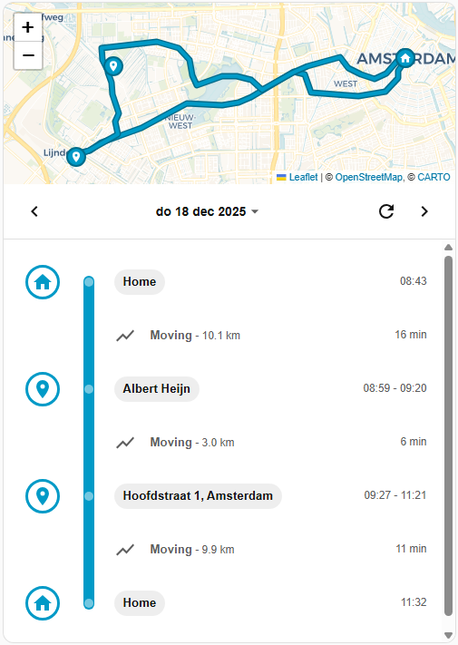

# Location Timeline Card (Home Assistant)

[![Stable][releases-shield]][releases] [![HACS Badge][hacs-badge]][hacs-link] ![Project Maintenance][maintenance-shield] [![GitHub Activity][commits-shield]][commits] [![License][license-shield]](LICENSE.md) [![Community Forum][forum-shield]][forum] [![Reddit][reddit-shield]][reddit]

[commits-shield]: https://img.shields.io/github/commit-activity/y/konewka17/timeline_card.svg
[commits]: https://github.com/konewka17/timeline_card/commits/master
[forum-shield]: https://img.shields.io/badge/community-forum-brightgreen.svg
[forum]: https://community.home-assistant.io/t/location-timeline-card-to-easily-show-location-history/989513
[reddit-shield]: https://img.shields.io/badge/discussion%20post-reddit-orange.svg
[reddit]: https://www.reddit.com/r/homeassistant/comments/1rbkxnk/location_timeline_card_to_easily_show_location/
[license-shield]: https://img.shields.io/github/license/konewka17/timeline_card.svg
[maintenance-shield]: https://img.shields.io/maintenance/yes/2026.svg
[releases-shield]: https://img.shields.io/github/release/konewka17/timeline_card.svg
[releases]: https://github.com/konewka17/timeline_card/releases/latest
[hacs-badge]: https://img.shields.io/badge/HACS-Default-41BDF5.svg
[hacs-link]: https://hacs.xyz/

Location Timeline Card is a custom Lovelace card that builds a **timeline–style day view** from your Home Assistant location history. It turns raw GPS points into an easy-to-read daily story of where a person/device stayed and when they moved.

## What this card does



- Reads location history from a `device_tracker` or `person` entity
- Groups points into **stays** and **moves** using configurable thresholds
- Shows zone names when points are inside Home Assistant `zone.*` entities
- Supports reverse geocoding for stays outside zones
- Updates today's timeline and map live, through Home Assistant's history stream
- Keeps a per-day in-memory cache for snappy day-to-day navigation
- Runs fully in the frontend (no extra backend integration required)
- Draws the map with Home Assistant's own map engine, so it looks and behaves like HA's map card

Requires Home Assistant **2026.11** or newer.

## Installation (HACS)

1. Open **HACS → Frontend → ⋮ → Custom repositories**.
2. Add this repository URL.
3. Set category to **Dashboard**.
4. Click **Add**.
5. Find **Location Timeline Card** in HACS Frontend and click **Download**.
6. Restart Home Assistant (or reload frontend resources if prompted).

After installation, ensure the card resource is available in Lovelace (HACS normally registers this automatically).

## Manual installation

1. Download `timeline_card.js` from the latest GitHub Release.
2. Copy it to your Home Assistant `www` folder, for example `/config/www/timeline_card.js`.
3. Add it as a dashboard resource:

```yaml
url: /local/timeline_card.js
type: module
```

4. Refresh your browser cache.

## Usage

Add the card in the Lovelace UI editor or with manual YAML.

### Minimal setup

```yaml
type: custom:location-timeline-card
entities:
    - device_tracker.my_phone
```

The entity must expose latitude/longitude attributes.

### Multiple tracked entities

```yaml
type: custom:location-timeline-card
entities:
    - person.alice
    - person.bob
```

When multiple entities are configured, the card renders all tracks on the map and adds a selector bar above the date controls.

## Configuration options

The options follow the sections of the visual editor.

| Name                        | Type    | Default      | Description                                                                                                                                                             |
|-----------------------------|---------|--------------|-------------------------------------------------------------------------------------------------------------------------------------------------------------------------|
| `entities`                  | list    | **required** | One or more `device_tracker`/`person` entities to pull GPS history from, as ids or with [per-entity options](#per-entity-options).                                      |
| **Map display**             |         |              |                                                                                                                                                                         |
| `theme_mode`                | string  | `"auto"`     | Map theme: `auto` (follow the HA theme), `light`, or `dark`. As in HA's map card.                                                                                       |
| `map_style`                 | string  | `"default"`  | Map style, as in HA's map card: `default`, `colorful`, `natural`, `muted`, `gray` or `toner`, or a custom style.                                                        |
| `current_location_marker`   | string  | `"default"`  | With a single entity: `default` shows its current location as a blue dot, `entity` as HA's entity marker. Several entities always use entity markers.                   |
| `map_height_px`             | number  | `200`        | Height of the map area in pixels.                                                                                                                                       |
| `default_zoom`              | number  | `14`         | Maximum zoom level when the map fits itself to a stay or a short track (1–20). Higher is closer.                                                                        |
| `hide_current_location`     | boolean | `false`      | Hide the current location when viewing today.                                                                                                                           |
| `hide_unselected_on_map`    | boolean | `false`      | Fully hide non-selected entities' tracks/markers on the map instead of dimming them. Only the selected entity is shown.                                                 |
| `show_zones`                | boolean | `false`      | Draw all (non-passive) zones on the map, as HA's map card does.                                                                                                         |
| `cluster`                   | boolean | `true`       | Group nearby entity markers into one bubble, as HA's map card does. Can also be toggled with the button on the map.                                                     |
| `scale_ruler`               | boolean | `false`      | Show a scale ruler, in your unit system.                                                                                                                                |
| `animate_highlighted_path`  | boolean | `true`       | Animate ("marching ants") the currently-highlighted move segment to show direction of travel.                                                                           |
| **Timeline display**        |         |              |                                                                                                                                                                         |
| `distance_unit`             | string  | `"metric"`   | Distance unit for moving segments: `metric` (m, km) or `imperial` (ft, mi).                                                                                             |
| `hide_moving`               | boolean | `false`      | Hide moving rows and keep only stays.                                                                                                                                   |
| `reverse_timeline_order`    | boolean | `false`      | Show timeline items from latest to earliest within the selected day.                                                                                                    |
| `collapse_timeline`         | boolean | `false`      | Start with the timeline section collapsed on first render.                                                                                                              |
| `timeline_use_entity_color` | boolean | `false`      | Use the active entity track color for the timeline spine/dots/text instead of always using HA `--primary-color`.                                                        |
| `activity_icon_map`         | object  | `{}`         | Icons per activity, for entities with an `activity_entity`. See [Activity icons](#activity-icons).                                                                      |
| **Location names**          |         |              | see [Reverse Geocoding](#reverse-geocoding) below                                                                                                                       |
| `osm_api_key`               | string  | `null`       | Optional OSM Nominatim email address (used as API key) for reverse geocoding fallback.                                                                                  |
| **Advanced**                |         |              |                                                                                                                                                                         |
| `stay_radius_m`             | number  | `75`         | Radius (meters) used to detect a stay.                                                                                                                                  |
| `min_stay_minutes`          | number  | `10`         | Minimum duration (minutes) required to qualify as a stay.                                                                                                               |
| `max_reasonable_speed_kmh`  | number  | `300`        | Maximum plausible apparent speed (km/h) between GPS points. Removes one-point GPS jumps when the direct path around that point is within the limit. Set `0` to disable. |

## Per-entity options

Each entity can have its own options, with the same marker options as Home Assistant's map card. When specifying per-entity options, the entity id itself gets the key `entity: `. In the visual editor, use the pencil next to an entity.

```yaml
type: custom:location-timeline-card
entities:
    - entity: person.alice
      color: pink
      places_entity: sensor.places_alice
    - entity: device_tracker.bobs_car
      name: Car
      label_mode: icon
```

| Name              | Description                                                                                                             |
|-------------------|-------------------------------------------------------------------------------------------------------------------------|
| `entity`          | The `device_tracker`/`person` entity.                                                                                   |
| `name`            | Name on the marker, instead of the entity's initials.                                                                   |
| `color`           | Track and marker color: a theme color such as `pink`, or any CSS color. Without it, the card's default colors are used. |
| `label_mode`      | Marker content instead of the picture: `state`, `attribute` or `icon`, as in HA's map card.                             |
| `attribute`       | Attribute shown with `label_mode: attribute`.                                                                           |
| `unit`            | Unit after the attribute with `label_mode: attribute`.                                                                  |
| `places_entity`   | Places sensor for this entity, see [Reverse Geocoding](#reverse-geocoding).                                             |
| `activity_entity` | Activity sensor for this entity, see [Activity icons](#activity-icons).                                                 |

## Map interactions

- Hovering a timeline entry (desktop) highlights the matching segment on the map. A highlighted **move** segment animates ("marching ants") to show direction of travel when `animate_highlighted_path` is enabled (default).
- Clicking another entity's track, or its marker, selects that entity.
- The buttons under the zoom controls switch the map fit (full path, current location) and toggle marker grouping.

## Reverse Geocoding

For stays that are not clearly inside a Home Assistant zone, the card can resolve a human-friendly location name. This process is called **reverse geocoding**: converting latitude/longitude coordinates into an address or place label.

By default, Home Assistant only stores raw GPS coordinates in history. If you want meaningful labels like "Starbucks" or "Main Street 12" instead of just coordinates, you need to configure one of the following options.

1. **Preferred:** configure the [Places integration](https://github.com/custom-components/places) and set `places_entity` on the entity.
    - Install the Places integration (via HACS) and configure it for your tracked entity.
    - This integration creates a `sensor.places_*` entity that stores resolved place names.
    - Set that sensor as the [`places_entity`](#per-entity-options) of the tracked entity.
    - This is recommended because Places writes location labels into Home Assistant history. That means:
        - Labels are stored persistently.
        - Historic days load instantly without repeated API calls.
        - You get consistent naming over time.
    - Under the hood, Places uses the OpenStreetMap API to resolve coordinates into readable addresses or place names.

2. **Fallback:** configure `osm_api_key` with your **email address**.
    - Set `osm_api_key` to your email address (required by OpenStreetMap Nominatim usage policy).
    - The card will call OSM Nominatim directly from the frontend when no Places label is available.
    - Requests are rate-limited to at most one request per second to stay within OSM guidelines.
    - Responses are cached by the card (including "unknown" results) to avoid repeated lookups.
    - This is especially useful for resolving older historic stays if you have set up the Places entity later.
    - Note: Unlike Places, these labels are not written back into Home Assistant history.

Example:

```yaml
type: custom:location-timeline-card
entities:
    - entity: device_tracker.my_phone
      places_entity: sensor.places_my_phone
osm_api_key: me@example.com
```

If `osm_api_key` is not set, unresolved stays remain **Unknown location**.

## Activity icons

When an entity has an `activity_entity`, the card shows the activity on its move segments. `activity_icon_map` sets the icon per activity: keys are the activity names as your sensor reports them, values are MDI icons. Without a match, the default icon is used.

```yaml
type: custom:location-timeline-card
entities:
    - entity: person.alice
      activity_entity: sensor.alice_activity
activity_icon_map:
    Walking: mdi:walk
    Running: mdi:run
    Cycling: mdi:bike
    "In car": mdi:car
```

## Base map

The map runs on Home Assistant's own map engine, taken from the Home Assistant frontend: the same vector map styles, controls, markers and clustering as HA's map card, rendered with MapLibre GL. Browsers without WebGL2 get HA's raster fallback through Home Assistant's tile proxy. Nothing is downloaded from a third party beyond what HA's own map loads.

## Upgrading from v1

v2 changes several options. See [`upgrading-from-v1.md`](upgrading-from-v1.md) for how to convert your configuration.

## Notes

- The card reads raw GPS history from the tracked entity’s latitude/longitude attributes.
- Zone labels are resolved from `zone.*` entities.
- All timeline processing happens in the browser.
- [Discussion post](https://community.home-assistant.io/t/location-timeline-card-to-easily-show-location-history/989513) on the Community

## Debug mode
In some cases for me to properly debug issues, you will need to enable debug mode and send me the logs. If this is necessary, please follow these steps:
- Upgrade the card to the latest version by going to this repo in HACS, and clicking Update information.
- Hard refresh your dashboard with `Shift+F5`
- Go to this card's configuration, switch to yaml mode, and add the option `debug: true` as a parameter
- Save the config, you will now see a debug icon appear next to the date picker
- The card now writes map events to the Home Assistant log, under the logger `timeline_card`
- Navigate to a day where to issue occurs, and click the debug icon to also write that day's data to the log
- Go to Settings → System → Logs, open the ⋮ menu and choose Show raw logs (the regular view only keeps the last few messages), and search for `timeline_card`
- Copy those lines into a file, and send it to me privately via [email](mailto:konewka17.github@gmail.com)
  - Note that this log will contains your coordinates for that day, I'll handle them carefully and will only use it for debugging
- Please also share your full configuration
